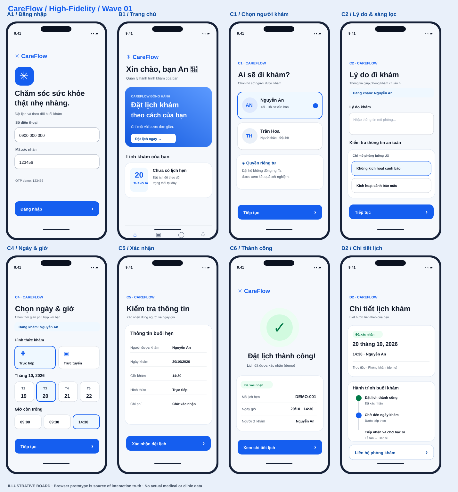

# CareFlow — High-Fidelity Wave 01

**Status:** interactive design prototype, synthetic data only • **Scope:** A1 → B1 → C1 → C2 → C4 → C5 → C6 → D2, plus safety fallback C3.  
**Version:** 0.1 • Date: 15/10/2026 • iOS-style and Android-responsive.

## Visual overview

[View the 8-screen High-Fidelity board](overview.svg) — an illustrative vector overview for side-by-side design review. The interactive HTML browser prototype is the source of truth for actual behavior; CI contains screenshots from Chromium/WebKit.



## Open

Open [index.html](index.html) in a browser, with the repository cloned so it can load `../prototype/model.js`:

```bash
git clone -b design/careflow-hifi-wave1 https://github.com/Ngh1aa/Patient-Journey-App.git
cd Patient-Journey-App
python3 -m http.server 8000
# http://localhost:8000/hifi/
```

**Note:** GitHub's `blob` link displays source; it is not a hosted interactive demo. `index.html` also works as a local file when the entire repo folder is preserved. No backend or real patient data.

## Screens
| ID | High-fidelity deliverable | Components |
|---|---|---|
| A1 | OTP login, welcome, clinic contact | text fields, helper, primary CTA |
| B1 | Dashboard, booking hero, upcoming appointment | 4-tab bar, appointment card, quick actions |
| C1 | “Ai đi khám?” first-step picker | person selector, delegated-rights note, sticky CTA |
| C2 | Reason + **non-clinical mock flag** | person context badge, accessible choices, screening notice |
| C4 | In-person/remote, date/time slots, empty-slot state | segmented mode, calendar strip, slot grid |
| C5 | Booking summary + slot conflict / unknown response | review card, failure/verification actions |
| C6 | Confirmed appointment with next actions | success feedback, appointment ID, details |
| D2 | Appointment details, timeline + owner, support | journey status, next action, tab bar |
| C3 supplemental | Safety-stop placeholder | human-help actions, no clinical advice |

## Design system
- Single source of suggested tokens: [design/tokens.json](../design/tokens.json) and [design/README.md](../design/README.md), inherited from the UI Foundations PR.
- Primary blue `#155EEF`, white on blue contrast 5.41:1, body 17pt; button height 52, card radius 20.
- Light/dark tokens, larger-type preview, responsive mobile browser. iOS visual hierarchy; Android navigation behavior must be implemented natively for production.
- Text and icons, no stock photography, no copied screenshots, no proprietary icon fonts bundled. Optional Google Fonts download with system font fallback.
- 4 navigation positions; two not in Wave 01 are disabled (not deceptive clickable links).
- All patient-facing content in Vietnamese; labels on fields and icon-only clinic-contact control.

## Start-to-end demo steps
1. A1 phone **0900000000**, OTP **123456** (fake, not sent).
2. B1 “Đặt lịch ngay”.
3. C1 choose self or Trần Hoa (relative; BOOK scope is simulated, VIEW_RESULT not granted).
4. C2 enter synthetic reason only and select “Không kích hoạt cảnh báo mẫu”.
5. C4 select *onsite* and **09:00 / 14:30** (09:30 disabled).
6. C5 check patient, day/time/mode; confirm.
7. C6 see generated `DEMO-001`; open D2.
8. D2 see distinct timeline stages and contact action (hotline not configured).

### Exception scenarios (left workspace panel)
- **Relative**: tests patient identity context and separate rights; does not expose results.
- **Warning**: opens C3 and prevents C4/C5/C6; editing mock answer cannot remove warning.
- **Slot unavailable**: C5 receives synthetic `SLOT_UNAVAILABLE` and blocks success; pick another slot.
- **Network timeout**: C5 receives `UNCONFIRMED_REQUEST`; must check before safe retry.
- **Telemedicine**: selecting online displays “clinic approval required” and prevents direct C5.
- No real clinical triage, no clinical advice, no real phone calls, no appointment writes.

## Test commands
```bash
npm install --prefix prototype
cd prototype
npx playwright install chromium webkit
npx playwright test -c hifi.config.cjs
```
CI on GitHub runs 10 cases × 2 mobile browser engines and the 26 existing model assertions. Screenshots of all 8 key screens appear as artifacts in CI. **Browser emulation is not an actual iPhone/Android device.**

## Handoff and sign-off
This is a **first visual wave**, not an app ready for healthcare use. C2/C3 clinical copy and escalation, telemedicine availability, family/proxy credentials, hotline, fee/slot sources, signed result release, and actual consent/records must be approved by the clinic and legal/privacy teams. Run moderated comprehension testing with diverse ages before implementation. Do not merge without reviewing CI/screenshots.

## Open issues
- Theme and larger-text controls are prototype previews, not native Dynamic Type / fontScale implementations.
- Full WCAG assessment, keyboard/screen reader testing and physical devices remain open.
- Production state/asset sync with clinic HIS/EMR and payment providers is out of scope.
