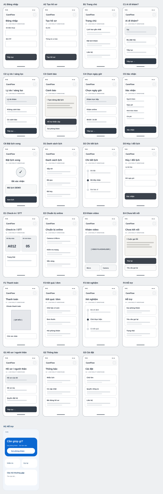

# CareFlow — Patient App Low-Fidelity Wireframes (23/23)

**Phiên bản:** v0.1 · 15/10/2026 · iOS + Android mobile-first · **DEMO ONLY**.  
**Thiết kế kế thừa:** [Research A–I, 23-screen specification](../research/README.md), [9 luồng bệnh nhân](../research/07-patient-user-flows.md), [state contracts](../research/08-state-contracts-permissions.md).  
**Không phải** ứng dụng y tế thật, không kết nối OTP/cấp cứu/phòng khám/video/payments, không được dùng để điều hướng bệnh nhân thật.

## Xem wireframe

**Bảng 23 màn hình dạng SVG:**



**Bản tương tác:** mở [index.html](index.html) trên máy tính sau khi clone/tải đầy đủ folder `prototype/`.

```bash
git clone -b design/careflow-lowfi-23-screens https://github.com/Ngh1aa/Patient-Journey-App.git
cd Patient-Journey-App
# mở prototype/index.html bằng browser (không cần build/npm)
# hoặc dùng local HTTP server tùy máy:
python -m http.server 8000
# rồi mở http://localhost:8000/prototype/
```

> GitHub file preview không thực thi prototype HTML, và hiện **chưa cấu hình GitHub Pages**; không coi đường dẫn `blob/.../index.html` là link demo chạy trực tuyến.

### Cấu trúc tệp

| File | Vai trò |
|---|---|
| [index.html](index.html) | shell web gồm sidebar, mobile canvas, scenario runner, inspector |
| [styles.css](styles.css) | wireframe grayscale, khung điện thoại 390px, bố cục responsive, vùng chạm, focus |
| [app.js](app.js) | nội dung **23/23 màn hình** và tương tác click |
| [model.js](model.js) | state machine mô phỏng tách actor/subject, warning, slot, payment, quyền người thân |
| [wireframe-board.svg](wireframe-board.svg) | overview trực quan 23 khung điện thoại, tự vẽ, không ảnh có bản quyền |
| [tests.cjs](tests.cjs) | 26 phép kiểm tra Node không cần thư viện bên ngoài |
| [USABILITY-TEST-PLAN.md](USABILITY-TEST-PLAN.md) | 5 kịch bản kiểm thử và phiếu ghi chú |
| [qa-model-results.md](qa-model-results.md) | kết quả 15 kiểm tra logic phiên bản đầu trong JS isolate, xem CI cho bộ 26 mới nhất |

## Tương tác: ưu tiên luồng chính

`A1 → B1 → C1 → C2 → C3` **hoặc** `C4 → C5 → C6 → D2`. C3 là đường nhánh cảnh báo, không liên thông tự động đến C4. C6 chỉ hiển thị booking thành công khi hàm xác nhận giả lập tạo appointment với **subject đúng**.

**Scenario switcher** bên trái:
1. **Tự đặt lịch:** đăng nhập số mẫu + OTP `123456`, chọn Đặt lịch → Tôi → chọn không có cảnh báo → ngày giờ → xác nhận.
2. **Đặt hộ:** bắt đầu tại C1, chọn Mẹ (mẫu), kiểm tra quyền BOOK nhưng không có VIEW_RESULT.
3. **Có cảnh báo:** bắt đầu C2, chọn kích hoạt cảnh báo → C3; việc trở lại C2 và thay câu trả lời **không tự xóa yêu cầu đánh giá**.
4. **Giờ khám đã hết:** bắt đầu C5, phản hồi máy chủ giả lập `SLOT_UNAVAILABLE`; C6 không được xuất hiện, quay lại C4 chọn giờ khác.
5. **Mất phản hồi mạng:** bắt đầu C5, máy chủ trả `UNCONFIRMED_REQUEST`, kiểm tra trạng thái trước khi retry; không tạo lịch trùng hoặc hiển thị thành công.

**Panel bên phải:** đổi kịch bản máy chủ `success` / `slot_unavailable` / `network_unknown`; nút chạy logic smoke tests trong trình duyệt. Danh sách màn hình trái dùng để khám phá UI; các màn nguy cơ bị chặn theo mô hình.

## Danh sách 23 màn

| Nhóm | ID | Tương tác |
|---|---|---|
| Onboarding | A1, A2 | OTP demo, tạo hồ sơ demo |
| Home | B1 | thẻ lịch gần nhất và hỗ trợ |
| Booking | C1–C6 | chọn người, lý do, cảnh báo, slot, review, success guard |
| Appointment | D1–D3 | danh sách, timeline, hủy/đổi và reason |
| Encounter | E1–E4 | check-in/STT tách biệt, chuẩn bị online, video placeholder, lỗi kết nối |
| Aftercare | F1–F4 | QR placeholder, kết quả có quyền truy cập, xét nghiệm, hotline/callback |
| Account | G1–G3 | proxy permission, notification deep link check, cỡ chữ |

## Testing

```bash
node prototype/tests.cjs
```

Kiểm tra mô hình bằng dữ liệu demo, **không gửi request lên server**, có thể chạy tự động qua GitHub Actions khi workflow được cấp phép. Nút “Chạy kiểm tra logic nhanh” trong browser kiểm tra 15 luật và inventory. **Không được gọi là usability testing với người thật**: phiên này chỉ là kiểm tra deterministic + chương trình test chuẩn bị sẵn.

## Ràng buộc đặc biệt
- Tất cả appointment IDs, profile, ngày và số thứ tự là **mock**. Không nhập triệu chứng thật vào textarea.
- C2/C3 chỉ mô phỏng trigger có/không cảnh báo; **không có bộ câu hỏi y khoa thực và không được tự cho phép khám từ xa sau cảnh báo**.
- C3 chưa có số hotline khẩn cấp chính thức. Không tự chèn hotline/địa điểm chưa được phòng khám xác nhận.
- Thông báo, đơn, kết quả, video và QR chỉ là placeholder, **không tự động thực hiện** giao dịch hay phát hành dữ liệu y tế.
- Việc phê duyệt phải có clinical/legal/operations; đặc biệt C2/C3, C1/G1, F1/F2. Bản browser là công cụ trao đổi thiết kế, không thể xác định compliance.
- Thay mock backend trước khi phát triển app thực, xây API contracts rõ cho booking, role access, result release và callback.

## Definition of Done trước high-fidelity
- Hoàn tất UAT kịch bản ở [USABILITY-TEST-PLAN.md](USABILITY-TEST-PLAN.md), ghi n và lỗi, điều chỉnh theo nhóm lớn tuổi và người đặt hộ.
- Không có lỗi P0 về nhầm người, vượt cảnh báo, hiển thị thành công giả, xem kết quả sai quyền hoặc xác nhận thanh toán giả.
- Các quyết định y tế/pháp lý/nhân sự quan trọng được người có thẩm quyền chấp thuận; không coi 26 model tests là clinical sign-off.
